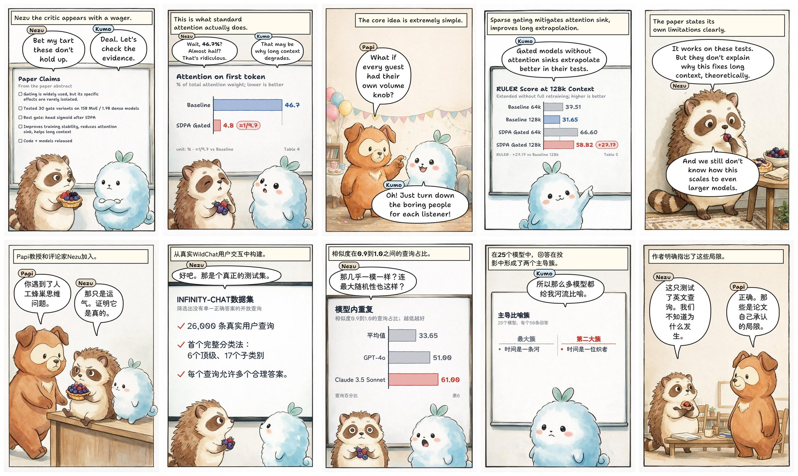

# Prism

**Turn academic papers into manga that an ADHD brain can actually finish.**

<p align="center">
  
</p>
<p align="center"><sub>Top: <i>Gated Attention for Large Language Models</i>, in English. Bottom: <i>Artificial Hivemind</i>, in Chinese.
Both are NeurIPS 2025 best papers. Every number on the boards was checked against the paper.</sub></p>

Prism reads a paper PDF and turns it into a short manga story that teaches what the paper's abstract says, with the
paper's own numbers drawn as charts. Three recurring characters carry it: Professor Papi, Kumo the PhD student and
Nezu the critic, who bets her berry tart that the paper's claims won't hold up. Seedream 5.0 Pro draws wordless
pictures; the program typesets every word and draws every chart, in English and Chinese on the same art.


## How it works

```
PDF ─▶ text + tables read from the page layout (the evidence ledger)
    ─▶ abstract claims ─▶ story with charts that cite table cells (Seed 2.0 Pro)
    ─▶ deterministic checks ─▶ fact-check by a second model family (DeepSeek V4 Pro) ─▶ abstract quiz ─▶ translation
    ─▶ wordless art (Seedream 5.0 Pro) ─▶ art check (Seed vision) ─▶ lettering + charts (bundled fonts) ─▶ reader
```

1. **Read the paper** (`services/paper_extractor.py`, `services/pdf_tables.py`). Body text in reading order, and every
   results table read from the page geometry: header paths, rows, sections, standard errors, spanning cells. Tables
   the reader is sure about (confidence ≥ 0.90) become the **evidence ledger** (`services/ledger.py`), appended to the
   paper text with an id per cell (`[T2.r9]   Transformer (big)   c1: 28.4`).
2. **Write the story** (`services/storyboarder_v2.py`). The abstract is split into claims; the writer builds a case:
   the claims on a board, Nezu bets against them, each claim is taught on the running example and checked with the
   paper's evidence, the authors' own limits close it. Where a table cell holds the number, a bar cites it
   (`"value": "@T2.r9.c1"`) and the program copies the value, the row name and the table; a number taken from the
   text needs a verbatim quote and must be found in the paper. One chart shows one column; the strongest other system
   of that column must be on it.
3. **Check it.** Deterministic lint (budgets, every number found in the paper, one column per chart, no "every claim
   was verified", no props that the image model would scribble on), a fact-check of every line and chart by a second
   model family (the writer's own model checks with the writer's blind spots), an abstract quiz on the visible panels
   (median of three graders), and a last scrub of any sentence whose number the paper lacks. The recap ticks a claim
   with numbers only when the story showed them.
4. **Translate** (DeepSeek V4 Pro): numbers locked per line, a glossary for the cast's props, rule checks for
   stronger claims, lost hedges and transliterated names; the Chinese fact-check's findings are written back to the
   English lines they came from.
5. **Draw and letter** (`services/panel_renderer.py`, `services/art_check.py`, `services/lettering.py`,
   `services/boards.py`). Wordless art with a calm top band or a blank whiteboard; a vision model finds heads, the
   board and stray glyphs, and up to three attempts fix what it finds. The words and charts are typeset in bundled
   fonts, so every OS renders the same manga. The art is saved, so re-lettering is free.

## Quality

Final check of this version (October 2026, details in `docs/v4-report.md`): 12 papers, each turned into a manga in
both languages. A reader who has never seen the paper looks only at the lettered panels and answers a fixed quiz that
covers every sentence of the abstract (`eval/quizzes/`: one fact per question, the abstract's own numbers as answers).
The same kind of reader also answers without the manga (closed book), which shows what it knew before.

| Papers | Reader | With the manga | Closed book |
|---|---|---|---|
| 4 from September and October 2026, newer than the readers' training data | Claude agents, strict grading | **90%** | 53% |
| | Seed 2.0 Pro (`backend/tools/eval_quiz.py`) | **70%** | 21% |
| 6 award papers (NeurIPS 2025 best papers, ICML 2026 outstanding papers) | Claude agents | 93% | 95% (they knew most of them) |
| | Seed 2.0 Pro | **86%** | 21% |
| 2 famous papers (Attention Is All You Need, BERT) | Claude agents | 93% | 100% |

The closed-book score is not zero because each question carries some of the abstract's context. On the four new
papers the manga adds 37 points for Claude and 49 for Seed; on the award papers, which Seed did not know, it adds 65.

- Every number on a board (chart, table or list) and in the text was checked against the paper. 69 of the 95 chart
  bars were copied from a table cell that the extractor read with confidence 0.90 or more; the others come from the
  text and passed the same check.
- Each script is fact-checked line by line by a second model family (DeepSeek V4 Pro) in both languages. A check
  that cannot run is retried, and if it still fails the reader page says so. The recap ticks a claim with numbers
  only when the story showed them.
- The weakest manga, on a management-science paper about delivery drivers, scored 70% (Claude) and 55% (Seed): it
  skipped the background sentences of the abstract.

`eval/` holds the fixed quizzes, pinned papers and the tool that reproduces these measurements with your own models
(`backend/tools/eval_quiz.py`; see `eval/README.md`).

## Quick start

### What you need
- Python 3.10+ (3.12 recommended) and Node.js 18.17+ (20+ recommended)
- A BytePlus ModelArk API key (<https://ai.byteplus.com/ark>) with these models activated in the console
  (Activation management):

| Model | Role | Required |
|---|---|---|
| `dola-seedream-5-0-pro-260628` | the pictures | yes |
| `seed-2-0-pro-260328` | the writer and the art check | yes |
| `dola-seed-2-1-turbo-260628` | line fitting, the quiz's reader | yes |
| `deepseek-v4-pro-ga-260813` | fact-checks and translation | recommended: without it these roles fall back to Seed 2.0 Pro on their own |

### Install and run
macOS / Linux:
```bash
git clone --depth 1 https://github.com/raucvr/Prism_manga-reader.git && cd Prism_manga-reader
cp config/api_config.yaml.example config/api_config.yaml
export ARK_API_KEY="your-modelark-key"      # or put it in config/api_config.yaml (gitignored)
./start.sh                                  # creates .venv, installs everything, starts both servers; ./stop.sh stops them
```
Windows: run `start.bat` (or `./start.sh` inside WSL2). In PowerShell, set the key with `$env:ARK_API_KEY="..."`
before starting, or `setx ARK_API_KEY "..."` and open a new terminal.

Open <http://127.0.0.1:3000>, drop a PDF, pick English or Chinese and press **Generate**. Both servers listen on
127.0.0.1 only and refuse changes from other sites: anything that can reach them can spend your ModelArk balance.

<details><summary>Manual install, mirrors and proxies</summary>

```bash
uv venv .venv --python 3.12 && uv pip install --python .venv/bin/python -r requirements.txt
# without uv: python3 -m venv .venv && .venv/bin/python -m pip install -r requirements.txt
(cd frontend && npm install)
(cd backend && ../.venv/bin/python -m uvicorn main:app --host 127.0.0.1 --port 8000)   # never --reload while jobs run
(cd frontend && npm run dev)            # in a second terminal; serves http://127.0.0.1:3000
```
On Windows the interpreter is `.venv\Scripts\python`.
Slow downloads from mainland China: `export UV_DEFAULT_INDEX=https://pypi.tuna.tsinghua.edu.cn/simple`,
`export UV_PYTHON_INSTALL_MIRROR=https://registry.npmmirror.com/-/binary/python-build-standalone`,
`npm config set registry https://registry.npmmirror.com`. Behind a TLS-inspecting proxy add `UV_SYSTEM_CERTS=1`.
Other ports: `BACKEND_PORT=8001 FRONTEND_PORT=3001 ./start.sh`.
</details>

### Cost and time

In the final check one manga in both languages (12 to 22 panels) cost $1.59 to $2.33 at ModelArk's list prices, $1.94
on average: about $1.15 for the pictures and $0.80 for the text, most of it DeepSeek's checks. It takes about half an
hour: 20 to 26 minutes for the story and its checks, 6 to 12 for the pictures. `.venv/bin/python
backend/tools/job_report.py output/<job_id>` prints a job's cost per model (images priced as Seedream 5.0 Pro).

## Configuration (`config/api_config.yaml`)

```yaml
core_engine:
  text_model: "byteplus/seed-2-0-pro-260328"                     # the writer
  check_model: "byteplus/deepseek-v4-pro-ga-260813?effort=high"  # fact-checks (falls back to text_model)
  translate_model: "byteplus/deepseek-v4-pro-ga-260813"          # translation (falls back to text_model)
  fast_text_model: "byteplus/dola-seed-2-1-turbo-260628"         # line fitting, the quiz's reader
  vision_model: "byteplus/seed-2-0-pro-260328"                   # the art check
  image_model: "byteplus/dola-seedream-5-0-pro-260628"           # or dola-seedream-5-0-flash-260915 (cheaper)
manga_settings:
  pipeline: v3          # wordless art + typeset text + code-drawn charts
  bilingual: true       # letter the same art in English and Chinese
  concurrency: 5        # parallel Seedream calls
  max_attempts: 3       # art attempts per panel
  min_panels: 16        # a story has 16 to 24 panels ("long": 28 to 40); the quiz may add up to 4
  max_panels: 24
  fast: false           # Seedream fast mode: about 40 s instead of about 110 s per panel
```
For a faster, cheaper run set `check_model` and `translate_model` to the Seed model (about 15 minutes and $0.5 less
per manga, with a weaker fact-check: see `docs/v4-report.md`).

### Characters
`config/character_images/` holds the reference sheets: `1. papi.png` (mentor), `2. kumo.png` (student),
`3. nezu.png` (critic). To re-skin the manga, replace the images and give each a new name after its number (e.g.
`1. fox.png`): the name becomes the character's name, and papi, kumo and nezu carry built-in look descriptions
(`backend/services/cast.py`) that would contradict a new picture. `clean/` holds caption-free copies of the current
sheets (with the hash of the sheet each was made from); a replaced sheet is used as it is.

## API

| Method | Endpoint | Description |
|---|---|---|
| `POST` | `/api/jobs` | multipart: `file` (PDF) or `text`, `language` (`en-US`/`zh-CN`), `panel_range` (`auto`/`short`/`long`), `fast` → 202 `{job_id, status}`. Checks the key and the text and vision models first (400 with what to do); Seedream is first called when drawing starts, so activate it before the first job |
| `GET` | `/api/jobs/{id}` | `status`, `stage_message`, `progress`, panels (`image_url`, `image_urls` per language), `quiz`, `quality` (checks that could not run), cost counters |
| `GET` | `/api/jobs` | recent jobs |
| `POST` | `/api/jobs/{id}/panels/{n}/regenerate` | redraw one panel |
| `POST` | `/api/jobs/{id}/relayout` | re-letter every panel from the saved art with the current code (no image calls) |
| `POST` | `/api/jobs/{id}/cancel` | stop a running job (finished panels are kept) |
| `GET` | `/output/{id}/…` | panels, `combined.jpg`, `storyboard.json`, `tables.json` |

State-changing requests from other web pages are refused (403), and so is any request addressed to a host other than
localhost or 127.0.0.1 (DNS rebinding); scripts and curl are unaffected. The raw model
routes `/api/generate/*` and the legacy paid `/api/manga/*` routes are off unless `server.enable_generate_api: true`.

## Development

```bash
uv pip install --python .venv/bin/python -r requirements-dev.txt   # without uv: .venv/bin/python -m pip install -r ...
(cd backend && ../.venv/bin/python -m pytest -q)    # no network; PDFs for some tests: backend/tests/fixtures/README.md
(cd frontend && npx tsc --noEmit && npm run build)  # stop the dev server first; no Google Fonts needed
.venv/bin/python backend/tools/job_report.py output/<job_id>     # attempts, quality and cost per model
.venv/bin/python -I backend/tools/dry_run.py paper.pdf --out DIR --languages en-US,zh-CN --mock --quiz eval/quizzes/<paper>.json
```
The dry run calls the text models (a job's text cost, up to about $0.80); `--mock` only replaces the pictures.

## Project structure

```
backend/
  engines/byteplus.py          ModelArk: chat (streamed when long), vision, Seedream; account errors with what to do
  services/paper_extractor.py  body text in reading order; the ledger appended
  services/pdf_tables.py       tables from the page geometry (headers, rows, sections, standard errors, spans)
  services/ledger.py           the evidence ledger: cell ids, binding charts to cells, the strongest rival
  services/storyboarder_v2.py  claims → story with charts → lint/fix → fact-check → quiz → translation (+ checks)
  services/boards.py           chart specs: normalize, check, draw (bar, table, flow, compare, links, list)
  services/evidence.py         every chart value and text number checked against the paper or a ledger cell
  services/abstract_quiz.py    reader / grader quiz on the visible panels
  services/art_check.py        vision grounding: heads, blank board, stray text, extra figures
  services/lettering.py        typesetting: narration, bubbles, tails, name tabs, charts on the board
  services/fonts.py            one font resolver over the bundled fonts (assets/fonts)
  services/engine_select.py    model roles (writer, checker, translator, vision, images) with fallbacks
  services/pricing.py          per-model prices for reports
  services/jobs.py             background jobs, bilingual lettering, relayout, quality record
  tools/                       dry_run, eval_quiz, fetch_papers, relayout, job_report
eval/                          fixed abstract quizzes and pinned papers
frontend/src/                  Next.js reader (中 / EN switch)
```

## Licensing

Prism is Apache-2.0. It depends on PyMuPDF, which is AGPL-3.0 (or commercial): running Prism as a network service
for others brings AGPL obligations. Bundled fonts (ChillRound M, Shantell Sans, Atkinson Hyperlegible Next, DejaVu
Sans, Inter) keep their own licenses: see `THIRD_PARTY_NOTICES.md`.

## Roadmap
- [ ] Redraw the paper's key figure (e.g. attention maps) from its vector data for the payoff
- [ ] Start the art while the translation and its check run (about 5 minutes less per manga)
- [ ] Next.js 15 (the remaining dependency advisories)
- [ ] Custom character upload from the UI; export to PDF / EPUB
